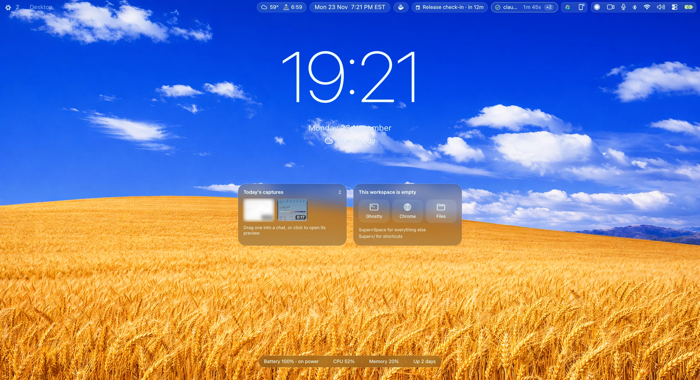
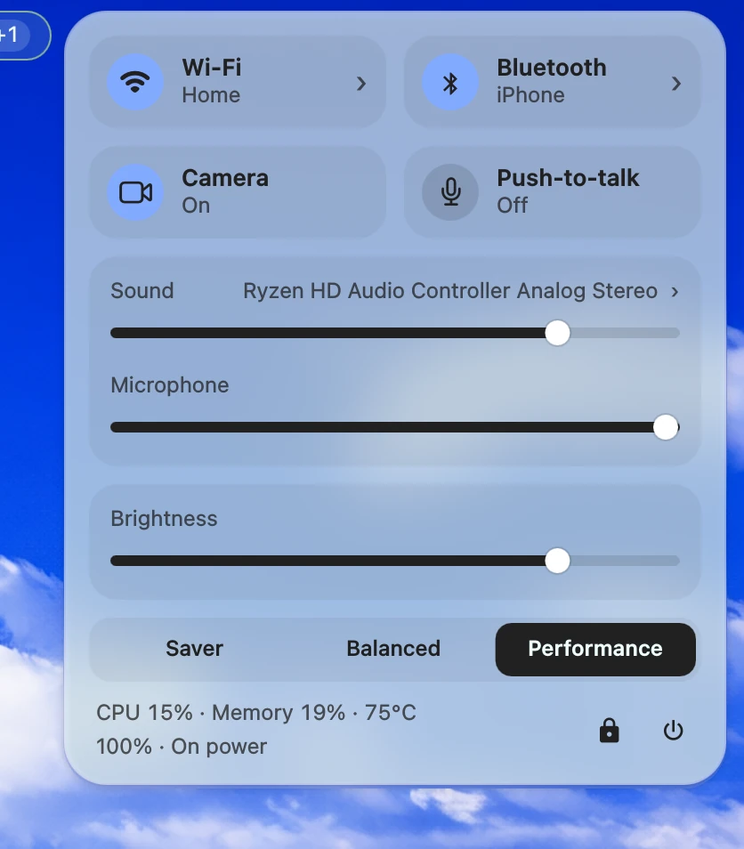
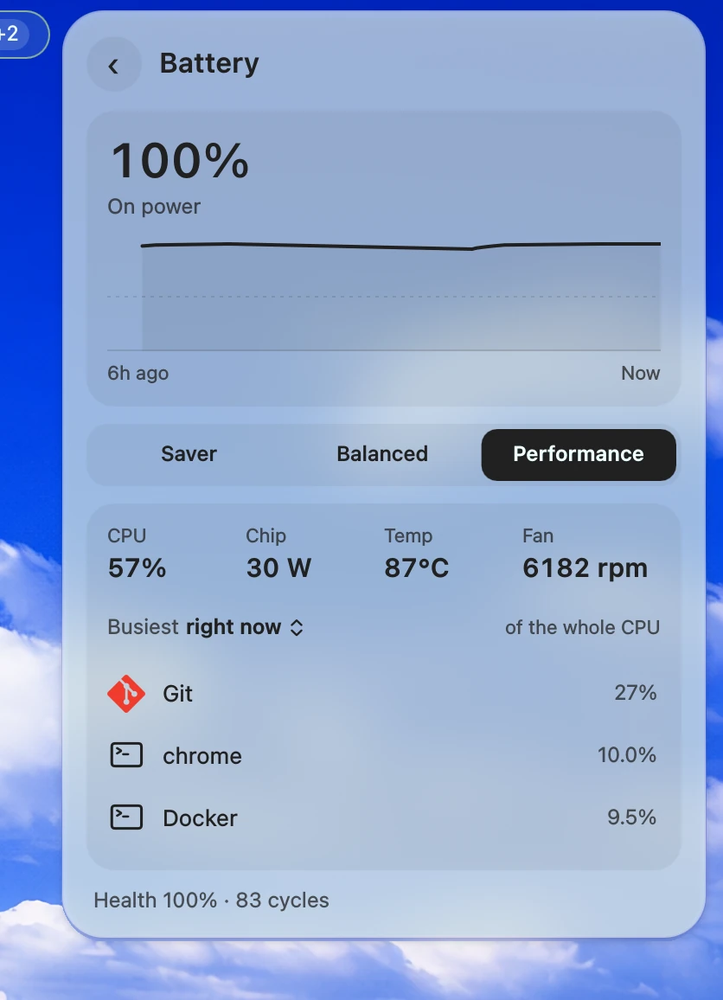
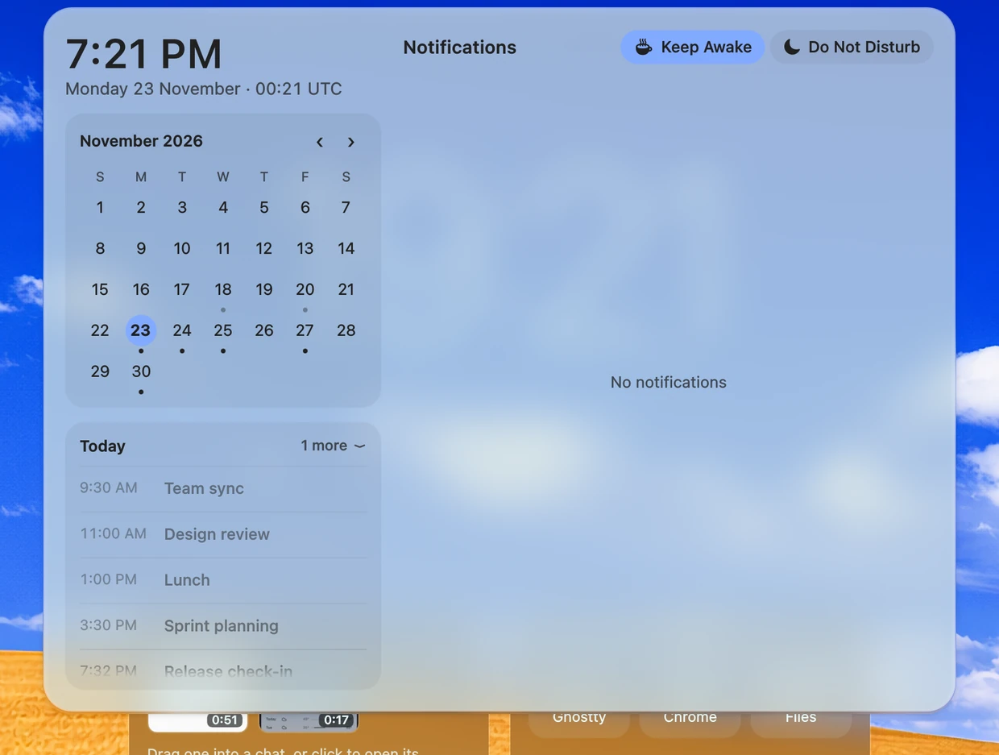
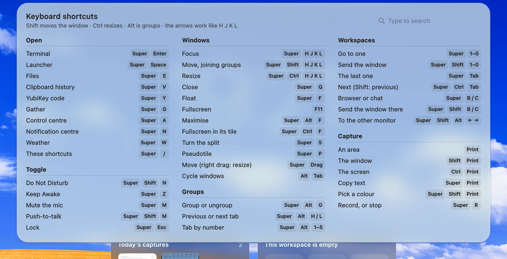
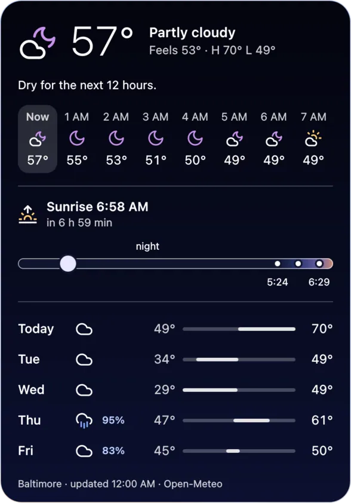
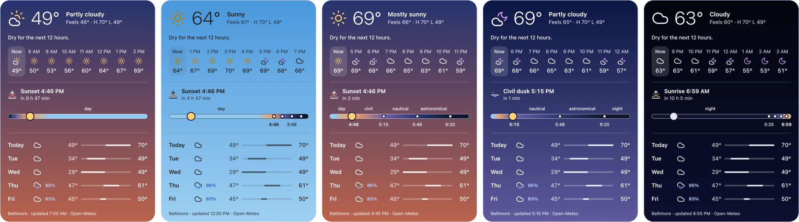
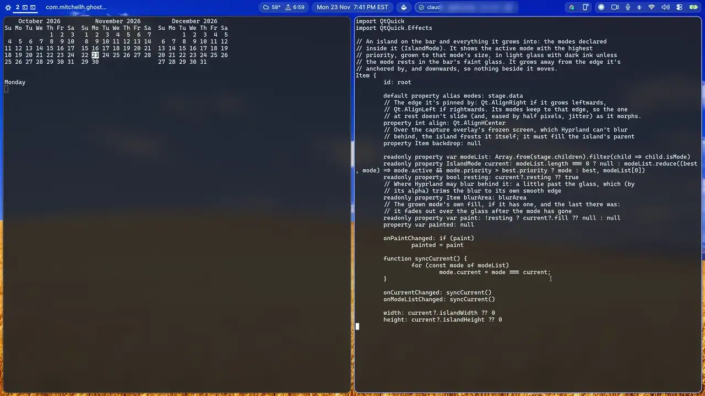

# nix-config

One laptop, declared end to end: NixOS and Home Manager on a Framework 13,
Hyprland configured in Lua, and **islands**, a desktop shell written for it.



Everything on screen above is this repository: the bar, the clock and cards
on the empty workspace, and what each island grows into. The screenshots on
this page were taken on a spare virtual monitor, so they show the real shell
with nothing else open. The calendar and the Wi-Fi name in them are stand-ins.

- [islands, the shell](#islands-the-shell)
- [The forecast](#the-forecast)
- [The little things](#the-little-things)
- [Numbers](#numbers)
- [Using this configuration](#usage)

## islands, the shell


A bar of islands. Each one rests as a pill and grows into what it's about: a
click on the weather grows it into the forecast, the clock into the
notification centre, the status icons into the control centre. One grows at
a time, out of the island you clicked, and Esc or a click anywhere else puts
it back.

It is one [Quickshell](https://quickshell.org) process, 89 QML files and
about 11,000 lines, and it took the place of six programs: waybar, mako,
swayosd, a Wi-Fi applet, blueman's applet and hyprpolkitagent. So the bar,
the notifications, the volume popup, the Wi-Fi and Bluetooth lists, and the
password prompts all look and move the same way, because they are the same
thing.

<table>
  <tr>
    <td width="50%"></td>
    <td width="50%"></td>
  </tr>
  <tr>
    <td><b>The control centre</b> grows out of the status icons. Wi-Fi, Bluetooth, sound devices and the battery each have a page it resizes to.</td>
    <td><b>The battery page</b> charts the last six hours and names the three busiest things on the machine: right now, on this stretch of battery, or today.</td>
  </tr>
</table>



**The notification centre** grows out of the clock: a calendar with a dot on
each day that has something on, the day's events, what's playing, and the
notification history, with Keep Awake and Do Not Disturb at the top.



**Every shortcut, one key away.** Super+/ grows the clock into the sheet.
Typing searches it: what doesn't match fades back, so nothing moves.

## The forecast



Click the weather and it grows into the forecast, painted as the sky of the
hour. On the right is one whole day of it: the real panel, with the clock
driven by hand and a made-up day of weather.

No weather service gives the twilights, so the shell works them out from
where the laptop is. The sun's line runs only as far as the next thing to
see.

<br clear="right">



## The little things

Most of the work went into details like these.

- **Nothing private on a shared screen.** While a screen share runs,
  notifications are held back and counted in the island, an orange frame
  goes round what's shared, and the bar names the focused app but never its
  window title.
- **A shared window can be resized.** Hyprland's screen-share portal froze a
  share for good the first time a frame failed to copy, which happens
  routinely while a shared window is being resized. A small patch carried
  here makes it try again, until
  [the fix lands upstream](https://github.com/hyprwm/xdg-desktop-portal-hyprland/issues/445).
  What to share is picked in the same overlay as a screenshot.
- **Questions are asked in the island.** A Wi-Fi password, a Bluetooth
  pairing code, the keyring, a program that needs root: each grows out of
  the clock, takes the keyboard, and goes away when answered. A YubiKey
  waiting for a touch is rimmed in Yubico's green.
- **Terminals report in.** A command running for more than ten seconds gets
  an island: `test:e2e 3:12`, then `passed 6m 04s` or `failed exit 1` until
  you look at its terminal. A click takes you there. Claude Code sessions
  show the same way. More on [what it leaves out](#the-job-island) below.
- **The next meeting sits by the clock** from half an hour before it starts,
  with Join if it has a link.
- **Capture is built in.** Print freezes the screen: drag an area, click a
  window, or take the whole screen, as a screenshot, a recording, its text,
  or a colour. A recording shows in the island with its size and a stop
  button, and opens in a preview with a trim when it ends.

  

  Above: an area dragged out, a window taken with one click, then the colour
  picker. It was filmed on a spare virtual monitor with the pointer driven
  by a script, since the overlay being filmed is the thing that normally
  does the filming.

  

- **Keep Awake is a switch, not a forgotten terminal.** While it's on,
  nothing dims, locks or suspends, and a steaming cup sits by the clock.
- **Push-to-talk works everywhere.** Armed from the mic icon, every
  microphone stays muted except while Right Alt is held. It is a small
  daemon of its own, so a crash of the shell can never leave a mic open.
- **An empty workspace is a dashboard.** The time, what's playing, today's
  captures to drag into a chat, something to start, and the machine's state
  in a line at the foot.
- **Links open where you are.** Chrome sends a link to whichever of its
  windows was used last, often on another workspace. Here a link clicked in
  a terminal or in Slack opens in the browser window on the same workspace,
  or in a new one there if it has none. From the chat workspace it goes to
  the nearest browser: one in view on another monitor, where the link shows
  beside chat, then the one on the workspace behind chat, then the one used
  last. Command-line tools (`gh`, a login flow) open links the same way.
- **Monitors come and go.** Each gets its own bar as it's plugged in, and a
  panel left open on one that's unplugged closes itself.

### The job island

A command that has been running in a terminal for more than ten seconds
gets an island beside the clock, so you can go and do something else:
`test:e2e 3:12` while it runs, then `test:e2e passed 6m 04s` or
`test:e2e failed exit 1` when it ends, until you look at its terminal. A
click takes you to that terminal; a right click puts the job away. With
more than one, the island shows `+2` and grows into the list, failures
first. A command you stopped yourself with Ctrl+C or Ctrl+Z is never
reported.

Some things run for a long time on purpose, and those are left out:

| Left out                      | Such as                                                                                                                |
| ----------------------------- | ---------------------------------------------------------------------------------------------------------------------- |
| Programs you work in          | `vim`, `less`, `man`, `ssh`, `tmux`, `htop`, `btop`, `watch`, `lazygit`, `yazi`, `fzf`, `psql`, `process-compose`      |
| A REPL started with no script | `python`, `node`, `bash`, `zsh` (but `python build.py` is a job)                                                       |
| Servers and watchers          | `npm run dev`, `pnpm start`, `nix develop`, `docker compose up`, `kubectl port-forward`, `tail -f`, anything `--watch` |

The match is on the command itself: aliases are expanded first, and
anything in front of it (`sudo`, `env`, a `cd … &&`, variable assignments)
is looked past.

To leave something else out, add it to one of the three lists at the top of
[`shell/Jobs.qml`](modules/hm/wms/islands/shell/Jobs.qml): a program's name
to `interactive`, a REPL's to `repls`, or a regular expression for a whole
command line to `patterns`. Then switch the home configuration.

### How it's put together

The shell keeps its state in singletons, one per subject, and draws it in
islands that know nothing of each other. Keybinds reach it through
`qs ipc -c islands call …`, so they know nothing of how it's drawn, and only
ten of its files know they are running on Hyprland.

The [islands README](modules/hm/wms/islands/README.md) has the map: what
depends on what, what it would take to lift the weather out for another
shell, and what is tied to the compositor.

Around it:

- **Hyprland in Lua**, with the [configuration notes](modules/hm/wms/hypr/README.md)
  on what that changed.
- **Three small programs** in `pkgs/`, built here: `bar-tools` (push-to-talk
  and the status watchers, in Rust), `islands-agent` (the Wi-Fi, Bluetooth
  and keyring prompts) and `capture-preview` (the window a capture opens
  in).
- **One theme.** Stylix picks the colours and fonts; the shell reads them
  from a file Home Manager writes, so a checkout runs as it is, with reload
  on every save.

## Numbers

Measured on this machine: a Ryzen AI 9 HX 370 driving a 4K screen at 144 Hz
and the laptop's own at 120 Hz.

### What it costs to run

Measured on 10 November 2026.

|                      | The six programs it replaced | islands              |
| -------------------- | ---------------------------- | -------------------- |
| Memory (PSS)         | 231 MB                       | 173 MB               |
| CPU at rest          |                              | about 1% of one core |
| CPU over 83 hours up |                              | 0.74% of one core    |
| Start to ready       |                              | 0.58 s               |

The shell also holds about 180 MB of graphics buffers, which that memory
figure doesn't count; the old programs' were never measured.

Of the 25 things the bar keeps up to date, 18 arrive as events, 4 are
polled, 2 are polled only while their page is showing, and 1 is read on
demand.

## What's using the CPU

The battery page of the islands shell (click the battery in the bar) lists
the three busiest things on the machine. Its title steps through three
lists when clicked or scrolled over: "Busiest right now", "on battery" and
"today".

### The three lists

| List       | Covers                                                                   | The percentage is                    | Comes from                                  |
| ---------- | ------------------------------------------------------------------------ | ------------------------------------ | ------------------------------------------- |
| Right now  | The last two seconds, refreshed every three                              | A share of the whole CPU, every core | `top`, read as the page shows               |
| On battery | The stretch on battery going on, or the last one of five minutes or more | A share of all the CPU used in it    | The recording [below](#the-recording) keeps |
| Today      | Since midnight                                                           | A share of all the CPU used in it    | The same recording                          |

"Right now" leaves out anything under 0.1%, the other two anything under
0.5%.

### What counts as one thing

A row is the thing that was asked for, not each process it started.

- **Apps** (a browser, Slack, the shell itself) are one row each, however
  many processes they have. The system keeps each in a group of its own,
  and the group is what's counted.
- **Work run from a terminal** is credited to the **job**: the command that
  was run, with everything it started. From each process the count goes up
  through its parents:
  - it stops at a **host**, which only runs other things: a shell waiting
    at its prompt, Claude Code, the terminal, tmux, process-compose,
    systemd. A host has only its own CPU, under its own name whatever
    started it.
  - it sees through a **wrapper**, which only passes a command on:
    `timeout`, `env`, `sudo`, `npx`, `npm run`, a shell given one command
    (`sh -c`). `npm ci` is npm's own work, so it is "npm".
  - the highest process left is the job. So the browsers a test run
    starts count as `playwright`, a compiler as the `go` or `make` that
    ran it, and `npm run dev` as `vite`.
- **Scripts** are named for what they run, not the runtime:
  `node …/.bin/vite` is "vite", with Node's icon.
- An app a job started (a test browser opens in a group of its own) is
  the job's, not an app.

Some examples:

| What happened                                                                     | Counted as                                                                                                                                               |
| --------------------------------------------------------------------------------- | -------------------------------------------------------------------------------------------------------------------------------------------------------- |
| Claude Code runs `npx playwright test`                                            | **Playwright**: the runner, the browsers it starts and their renderers. The `zsh -c` and `npx` in between are wrappers, and Claude Code gets none of it. |
| Claude Code works on a reply: streams it, draws its screen, reads and edits files | **Claude Code**. All of that happens in its own process.                                                                                                 |
| Claude Code starts an MCP server or a language server (`gopls`)                   | A row of its own each. Claude Code is a host, so the count stops below it.                                                                               |
| Claude Code runs `git commit`, and the pre-commit hooks lint and build            | **Git**: the hooks, linters and compilers are all part of that commit.                                                                                   |
| process-compose runs `air`, which rebuilds on every save                          | **air**: the watcher, the `go build` it runs, the compiler and the server it restarts.                                                                   |
| process-compose draws its screen and collects logs                                | **Process Compose**, and only that. Each service it runs is a row of its own.                                                                            |
| A script starts process-compose (`./dev.sh`)                                      | The script's own CPU is "dev". Process Compose and its services are counted as above.                                                                    |
| You type `go test ./...` at a prompt                                              | **go**: the compiler, the linker and the test binaries. The shell is "zsh", with only what its prompt uses.                                              |
| `nix build`, from anywhere                                                        | **Nix** for the command (evaluating), **Nix builds** for the building, which the daemon does as a service.                                               |
| A container, whoever started it                                                   | **Docker**. Containers run under Docker's daemon, not under the job that asked for them.                                                                 |
| Claude Code runs something quick (`ls`, a `grep`)                                 | Its own name if it was caught running, otherwise **Terminal commands** (see [the recording](#the-recording)).                                            |
| A loop that waits: `while pgrep x; do sleep 1; done`                              | Next to nothing. Waiting processes are given none of the CPU that could not be measured.                                                                 |

Names that are one thing are added together and shown under one name with
its icon: Docker's daemons and containers, a Go build's compiler and
linker, Chrome's two ways of starting. `app()` in
[BatteryPage.qml](modules/hm/wms/islands/shell/BatteryPage.qml) has those;
the rules for jobs are the `jobs` block of
[islands-usage](modules/hm/wms/islands/islands-usage).

### The recording

[below](https://github.com/facebookincubator/below) records every group's
and every process's CPU every five seconds and keeps three days of it
(`services.below` in [modules/nixos](modules/nixos/default.nix)). Reading
it back is slow, so a timer adds what's new to per-app totals every five
minutes, in five-minute steps, and the page reads those
(`islands-usage update` and `report`; the totals are in
`~/.cache/islands/usage`).

Two things in it are estimates:

- below can only measure a process it has seen twice. One that came and
  went within a few seconds has no figure of its own, though its group's
  total includes it. What a terminal used beyond the processes measured
  goes to the jobs that had new processes there, by how busy each looked:
  what its measured processes used, plus the new ones that were running
  at that moment. One that was only waiting (a `sleep` in a loop, a
  `tail`) gets none.
- **Terminal commands** is what's left when no job looked busy: work too
  brief to have been seen at all.

It also notes when the charger goes in and out, as the battery itself
can't be trusted to say: that's where "on battery" begins and ends.

### Looking closer

Clicking a row opens a window on it:

- from "right now", `btop` as a tree, showing only that job and what it
  runs;
- from the other two, a report on that row (`islands-usage look`): how
  much it used and when, across the time the list covers, and what ran as
  part of it in its busiest five minutes, as a tree with the CPU measured
  for each branch. For a "Git" row that is the commit, the hooks it ran,
  and the linters and tests under them:

  ```
  In those five minutes (CPU-seconds below measured, processes, …)
       1047    236  git
       1047    224  ├─ prek
        720     31  │  ├─ golangci-lint
        172     47  │  ├─ go
        144     87  │  └─ node:vitest
  Started as
       1047     3×  git commit -q -F -
  ```

  "Terminal commands" has no processes of its own, so its report lists
  the brief ones seen in the terminals then. `b` goes on to below's own
  recording of those minutes, replayed (`p` for processes, `c` for
  groups).

## Usage

The system and the home are built separately (Home Manager is standalone),
so most changes need only one of the two.

```sh
nh os switch . -H framework              # system    (alias: rb)
nh home switch . -c ewardner@framework   # home      (alias: rbh)
```

### Update inputs

```sh
nix flake update
```

Then rebuild both. The `upd` alias updates the lock file and switches the
home only; run `rb` after it for the system.

### Format and check

```sh
nix fmt                     # format everything (treefmt)
nix flake check             # the pre-commit hooks: treefmt, flake-checker, convco
scripts/check-hyprland.sh   # render the Hyprland Lua config and verify it
```

With direnv, entering the directory loads the dev shell and installs the
pre-commit hooks.

## Structure

```
flake.nix                  # inputs, the `user` block, hosts, packages
├── hosts/
│   ├── framework/         # the laptop
│   │   ├── configuration.nix
│   │   ├── disks.nix            # disko: LUKS, btrfs subvolumes, swapfile
│   │   ├── hardware-configuration.nix
│   │   └── home-overrides.nix   # monitors, sensors, wallpaper
│   └── iso/               # the installer image and its install script
├── home/home.nix          # Home Manager entry (imports modules/hm)
├── modules/
│   ├── nixos/             # system modules
│   ├── hm/                # home modules: shell, git, editors, wms/ (Hyprland, islands, launchers)
│   └── stylix/            # theme, fonts, wallpapers (shared by both)
├── pkgs/                  # our own packages, added to pkgs by an overlay
└── scripts/
```

Modules sit under one `modules.*` option namespace, most of them on by
default; a host turns things on or off in its `configuration.nix` and
`home-overrides.nix`.

The packages in `pkgs/` are also flake outputs, for use on their own:

```sh
nix build .#bar-tools   # also: islands-agent, capture-preview
```

## Adding a host

1. Create `hosts/<hostname>/` with `configuration.nix` (importing
   `../../modules/nixos`), `disks.nix` and `home-overrides.nix`. Copying
   `hosts/framework` is the quickest start. The installer writes
   `hardware-configuration.nix`.
2. In `flake.nix`, add the host and its nixos-hardware modules to `hosts`:

   ```nix
   hosts = {
     framework = { ... };
     <hostname> = {
       hardwareModules = [ nixos-hardware.nixosModules.<model> ];
     };
   };
   ```

3. Add its home configuration next to the existing one:

   ```nix
   "${user.username}@<hostname>" = mkHome "<hostname>";
   ```

## Fresh install

The build, the install and the first boot below were last run in a virtual
machine on 2026-11-21, installing `framework` to a blank disk.

### Build the installer

```sh
nix build .#iso
# Find the USB stick with lsblk first.
sudo dd if="$(ls result/iso/*.iso)" of=/dev/sdX bs=4M status=progress conv=fdatasync
```

The image carries a copy of this repository, so build it from the commit
you want installed.

### Install

Boot the stick and get online (`nmtui` for Wi-Fi), then:

```sh
sudo run-install framework              # the host, as named in flake.nix
sudo run-install framework /dev/sda     # or onto a disk other than /dev/nvme0n1
```

It asks before erasing the disk, then:

1. generates the host's `hardware-configuration.nix` for this machine,
2. partitions and encrypts the disk, asking for the passphrase,
3. installs the system,
4. copies this repository to `~/nix-config`,
5. asks for the user's password.

If the new swapfile's offset isn't the one in the host's
`configuration.nix`, it says so at the end; hibernation needs the two to
match.

### After the first boot

The first boot unlocks the disk and logs straight in to a bare Hyprland
with its stock config: the home isn't built yet. Super+Q opens a terminal
(kitty, which the system installs for this).

1. Get online (`nmtui`) and restore the SSH keys. The home configuration
   has a private input fetched over SSH, so it can't be built without them.
2. Build the home: `nh home switch ~/nix-config -c ewardner@<hostname>`,
   then reboot.
3. Make `~/nix-config` a checkout again; the installer's copy has no git
   history:

   ```sh
   cd ~/nix-config
   git init -b main
   git remote add origin git@github.com:EricWardner/nix-config.git
   git fetch origin
   git reset origin/main
   git branch -u origin/main
   ```

   `git status` then shows what the installer changed: the generated
   `hardware-configuration.nix`, to commit.

Not in this repository, to restore by hand:

- `/etc/nix/private-modules.env`, read by the Nix daemon.
- The keyring: Wi-Fi passwords, the `gh` and `fj` logins, and the
  calendar's address (`secret-tool store service islands-calendar`).
- Everything in the home directory. Nothing here backs it up.

## Using it for someone else

Identity is in the `user` block in `flake.nix`:

```nix
user = {
  username = "jdoe";
  fullName = "Jane Doe";
  work = {
    email = "jdoe@example.com";
    signingKey = "~/.ssh/id_ed25519_sk.pub";
    githubOrg = "example-org";
  };
  personal = {
    email = "jane@example.org";
    signingKey = "~/.ssh/id_ed25519_sk.pub";
    githubUsername = "jdoe";
  };
};
```

That isn't everything. Before it builds for anyone else:

- Remove the private `team-claude-skills` input and
  `modules.ai.team-skills.enable` in `home/home.nix`.
- Replace the work-specific parts: the Gather launcher and its window rules
  (`work.tiberius.com`), the Forgejo client ID in `modules/hm/default.nix`,
  and the YubiKey serial in the `oath` command in `hyprland.nix`.
- Set monitors and sensor paths in the host's `home-overrides.nix`.

## Beta: an iPhone, linked

Still being lived with, and off unless a host turns it on:
[Tether](https://github.com/zackb/tether) links an iPhone to the laptop over
Bluetooth, with no Mac and no Apple ID sign-in.

```nix
programs.tether = {
  enable = true;
  bluetooth.enable = true;     # texts and notifications
  wifi.enable = true;          # clipboard, files and links, on trusted networks only
  wifi.openFirewall = true;
};
```

The options are Tether's own NixOS module, from its flake;
`modules/nixos/tether.nix` adds the daemon's user service and the phone's
audio.

What works:

- **Texts and notifications arrive** in the shell's own notifications, under
  the phone app's name and with an icon to match.
- **The clipboard, files and links** cross over Wi-Fi, but only on networks
  you trust. Tether stays hidden everywhere else; trust the current one
  with `tether --trust-network`, and list them with `tether --networks`.

What doesn't, all of it down to what an iPhone will share over Bluetooth:

- Messages sent from the phone never appear on the laptop.
- Group chats arrive as one-to-one messages from whoever wrote.
- No attachments and no reactions.

So for now it is mostly a notification mirror.
