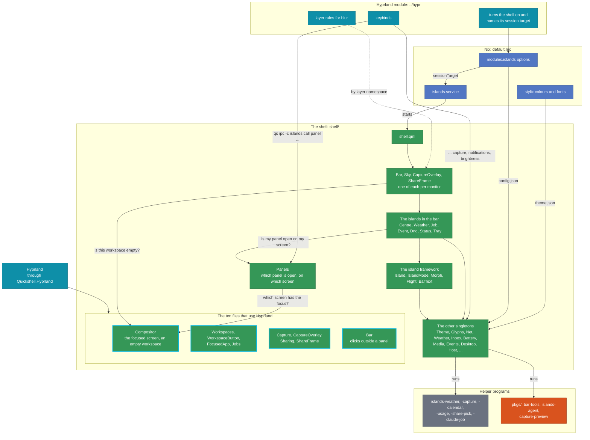
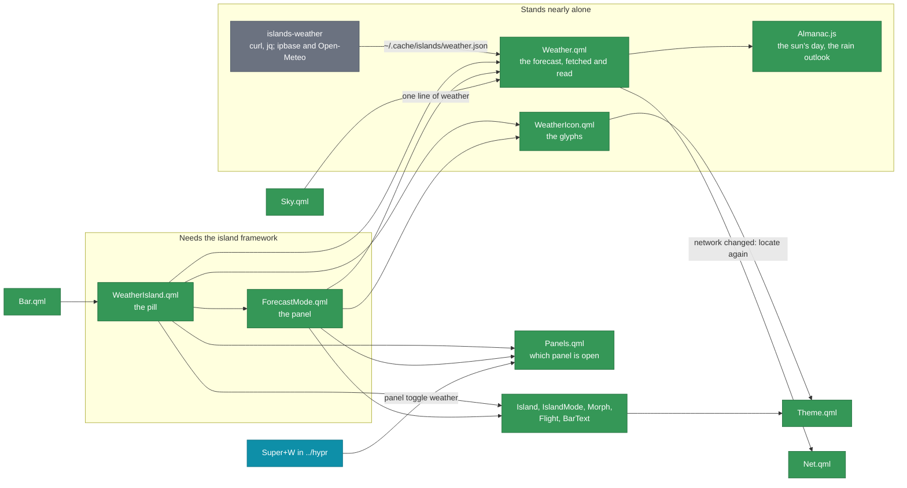

# islands

The desktop shell: a bar of islands that grow into panels, the notification
server, the control centre, the capture overlay and Sky, the desktop of an
empty workspace. The top of `default.nix` says how to run a development copy.

This page is a map of what depends on what, for taking a piece out or
moving the shell somewhere else.

## What's built in what

<table>
  <tr>
    <td width="33%" align="center"> <b>The shell</b> QML on <a href="https://quickshell.org">Quickshell</a></td>
    <td width="33%" align="center"> <b>Three programs</b> Rust, in <code>pkgs/</code></td>
    <td width="33%" align="center"> <b>The compositor</b> Hyprland, configured in Lua</td>
  </tr>
  <tr>
    <td valign="top"><code>shell/</code>: 89 files, about 11,300 lines. Every island and panel, the notification server, the tray, the polkit agent, the capture overlay and Sky.</td>
    <td valign="top">About 3,100 lines. <code>bar-tools</code>: the push-to-talk daemon and the mic and webcam watchers. <code>islands-agent</code>: the Wi-Fi, Bluetooth and keyring prompts. <code>capture-preview</code>: the GTK window a capture opens in.</td>
    <td valign="top">Ten of the shell's files talk to it, listed <a href="#what-is-tied-to-hyprland">below</a>. Keybinds and blur rules live in <a href="../hypr"><code>../hypr</code></a>.</td>
  </tr>
</table>

The rest is glue, next to this file: Bash for the weather, captures, CPU
usage, the share picker and the Claude Code hooks; Python for the calendar;
a zsh hook that reports terminal jobs. `default.nix` packages all of it and
starts the shell as `islands.service`.

## How it fits together

<b>The full map</b>: every edge, and what each one asks

Coloured by language as above: green QML, orange Rust, grey Bash and
Python, blue Nix, teal Hyprland.

- **Nix** packages the helper scripts, links `shell/` into
  `~/.config/quickshell/islands`, and writes two files the shell reads at
  start: `~/.config/islands/theme.json` (the stylix palette and fonts, for
  `Theme.qml`) and `config.json` (this machine's sensors and units, for
  `Host.qml` and the scripts). Nothing in `shell/` is generated, which is why
  a checkout runs with `qs -p`.
- **The singletons** hold all state and talk to the outside: one file per
  subject, each usable from any island. `Theme` is used by 57 files, `Glyphs`
  by 26, `Panels` (which panel is open, and on which screen) by 23; the rest
  by a handful each.
- **An island** is an `Island` holding one or more `IslandMode`s: the pill at
  rest, and what it grows into. `Bar.qml` declares each island and names it
  once more in its `islands` list, from which it works out where clicks land
  and where Hyprland may blur. Islands are not plugins: adding or removing
  one is that edit to `Bar.qml`.
- **Keybinds** live in the Hyprland module and reach the shell only through
  `qs ipc -c islands call <target> ...` (`panel`, `capture`, `notifications`,
  `keepawake`, `brightness`, `prompt`). The commands themselves know nothing
  of Hyprland.

## Taking the weather widget out

The widget is six files, about 1,400 lines, and comes apart in two halves.

- **The data and the icons** (`islands-weather`, `Weather.qml`,
  `Almanac.js`, `WeatherIcon.qml`) drop into any Quickshell configuration.
  `Weather.qml` touches the rest of the shell in one place, `Net`, to look
  for the machine again when the network changes; `WeatherIcon.qml` takes
  its tints from `Theme`. The script wants `curl`, `jq` and, optionally,
  `~/.config/islands/config.json` for the unit.
- **The working out is tested.** `Almanac.js` holds the sun's day and the
  rain outlook as plain functions, with no clock or file of its own, so
  [`tests/almanac.test.mjs`](tests/almanac.test.mjs) runs it under Node:
  `node --test tests/*.test.mjs` here, or `nix flake check`. The tests walk
  every crossing of the sun through whole months in several places and time
  zones, so a dusk on the wrong day, a step counted twice on the night the
  clocks change, or a missing sunrise fails one.
- **The pill and the panel** are an `Island` and an `IslandMode`, so they
  come with the framework (`Island`, `IslandMode`, `Morph`, `Flight`,
  `BarText`, `Theme`: about 400 lines) and with `Panels`, which says which
  panel is open. Neither imports anything of Hyprland's: the pill is told
  which of Quickshell's screens it is on.
- **To remove it from this shell**: the `WeatherIsland` in `Bar.qml` and its
  name in the `islands` list, the weather line in `Sky.qml`, the row in
  `KeysMode.qml`, the `weather` bind in `../hypr/hyprland.nix`,
  `islandsWeather` with its two options in `default.nix`, and the
  `islands-almanac` check in `flake.nix`.

## What is tied to Hyprland

Ten of the shell's files import `Quickshell.Hyprland`, each because it does
real work with it. The islands know the monitor they are on as Quickshell's
own `ShellScreen`, which any compositor has, and ask `Compositor` what
only Hyprland can say about it.

| What                                                           | Where                                                                                                    | To move it                                                                      |
| -------------------------------------------------------------- | -------------------------------------------------------------------------------------------------------- | ------------------------------------------------------------------------------- |
| Which screen has the focus, and whether its workspace is empty | `Compositor`, the one place a screen is matched to a Hyprland monitor                                    | Rewritten there                                                                 |
| A monitor's position and scale, for captures                   | `CaptureOverlay`, `Capture`, `ShareFrame`                                                                | From the new compositor, or from Quickshell's screen                            |
| Workspaces                                                     | `Workspaces`, `WorkspaceButton`                                                                          | Rewritten against the new compositor                                            |
| Windows                                                        | `FocusedApp`, `Capture` (window shots), `Sharing`, `Jobs` (focusing a terminal)                          | Rewritten; some of it may have no equivalent                                    |
| Clicks outside a panel                                         | `HyprlandFocusGrab` in `Bar`                                                                             | Another way to catch them                                                       |
| Choosing what to share                                         | `islands-share-pick` as xdg-desktop-portal-hyprland's picker; `Sharing` reads `hyprctl` options          | The new compositor's portal decides                                             |
| Blur behind the islands                                        | Layer rules in `../hypr/lua/rules.lua`, by namespace (`islands-bar`, `islands-sky`, `islands-capture`)   | The new compositor's rules, if it blurs layers                                  |
| Keybinds                                                       | `../hypr/hyprland.nix`                                                                                   | Bound again; the `qs ipc` commands stay as they are                             |
| The session                                                    | The Hyprland module turns `modules.islands` on and sets its `sessionTarget` to `hyprland-session.target` | The new compositor's module does the same; the default is any graphical session |

Everything else (notifications, the tray, sound, Bluetooth, Wi-Fi, battery,
media, calendar, weather, prompts) goes through Quickshell's own services,
D-Bus or the helper programs, and does not care which compositor is running.
Screenshots and recordings are taken by `grim` and `wl-screenrec`, which work
wherever the compositor offers wlroots' screen-copy protocol.
