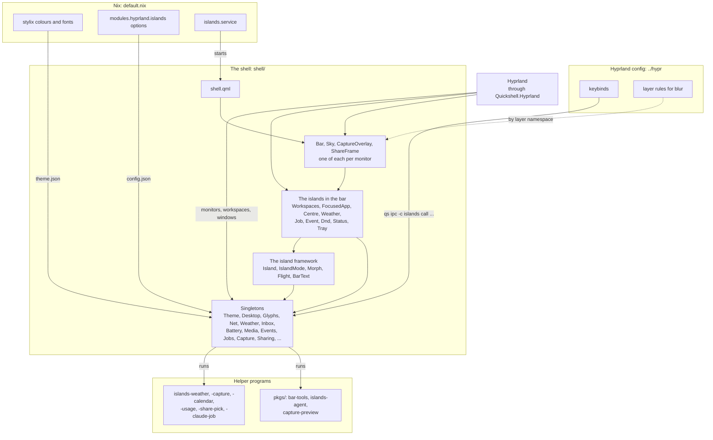
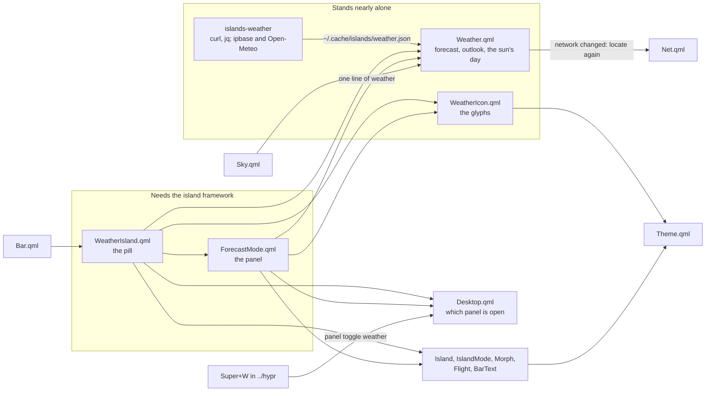

# islands

The desktop shell: a bar of islands that grow into panels, the notification
server, the control centre, the capture overlay and Sky, the desktop of an
empty workspace. It is a [Quickshell](https://quickshell.org) configuration
(`shell/`, about 11,000 lines of QML) with a handful of helper programs
around it. The top of `default.nix` says how to run a development copy.

This page is a map of what depends on what, for taking a piece out or
moving the shell somewhere else.

## How it fits together

- **Nix** packages the helper scripts, links `shell/` into
  `~/.config/quickshell/islands`, and writes two files the shell reads at
  start: `~/.config/islands/theme.json` (the stylix palette and fonts, for
  `Theme.qml`) and `config.json` (this machine's sensors and units, for
  `Host.qml` and the scripts). Nothing in `shell/` is generated, which is why
  a checkout runs with `qs -p`.
- **The singletons** hold all state and talk to the outside: one file per
  subject, each usable from any island. `Theme` is used by 57 files, `Desktop`
  (which panel is open, and on which monitor) by 29, `Glyphs` by 26; the rest
  by a handful each.
- **An island** is an `Island` holding one or more `IslandMode`s: the pill at
  rest, and what it grows into. `Bar.qml` places each island by hand and
  keeps the bar's input region for it, so islands are not plugins: adding or
  removing one is an edit to `Bar.qml`.
- **Keybinds** live in the Hyprland module and reach the shell only through
  `qs ipc -c islands call <target> ...` (`panel`, `capture`, `notifications`,
  `keepawake`, `brightness`, `prompt`). The commands themselves know nothing
  of Hyprland.

## Taking the weather widget out

The widget is five files, about 1,300 lines, and comes apart in two halves.

- **The data and the icons** (`islands-weather`, `Weather.qml`,
  `WeatherIcon.qml`) drop into any Quickshell configuration. `Weather.qml`
  touches the rest of the shell in one place, `Net`, to look for the machine
  again when the network changes; `WeatherIcon.qml` takes its tints from
  `Theme`. The script wants `curl`, `jq` and, optionally,
  `~/.config/islands/config.json` for the unit.
- **The pill and the panel** are an `Island` and an `IslandMode`, so they
  come with the framework (`Island`, `IslandMode`, `Morph`, `Flight`,
  `BarText`, `Theme`: about 400 lines) and with `Desktop`'s idea of the open
  panel. `WeatherIsland.qml` also takes a `HyprlandMonitor`, only to say
  which monitor its panel is open on.
- **To remove it from this shell**: the `WeatherIsland` in `Bar.qml` and its
  input region, the weather line in `Sky.qml`, the row in `KeysMode.qml`, the
  `weather` bind in `../hypr/hyprland.nix`, and `islandsWeather` with its two
  options in `default.nix`.

## What is tied to Hyprland

Twenty of the shell's files import `Quickshell.Hyprland`. Most only pass a
monitor around; a few do real work with it.

| What                                                              | Where                                                                                                  | To move it                                                                         |
| ----------------------------------------------------------------- | ------------------------------------------------------------------------------------------------------ | ---------------------------------------------------------------------------------- |
| Which monitor (`HyprlandMonitor`, `monitorFor`, `focusedMonitor`) | `Desktop`, `Bar`, each island, `Sky`, `CaptureOverlay`, `ShareFrame`, `Metrics`                        | Mechanical: Quickshell's own screens, plus the focused one from the new compositor |
| Workspaces                                                        | `Workspaces`, `WorkspaceButton`, `Desktop.workspaceEmpty`                                              | Rewritten against the new compositor                                               |
| Windows                                                           | `FocusedApp`, `Capture` (window shots), `Sharing`, `Jobs` (focusing a terminal)                        | Rewritten; some of it may have no equivalent                                       |
| Clicks outside a panel                                            | `HyprlandFocusGrab` in `Bar`                                                                           | Another way to catch them                                                          |
| Choosing what to share                                            | `islands-share-pick` as xdg-desktop-portal-hyprland's picker; `Sharing` reads `hyprctl` options        | The new compositor's portal decides                                                |
| Blur behind the islands                                           | Layer rules in `../hypr/lua/rules.lua`, by namespace (`islands-bar`, `islands-sky`, `islands-capture`) | The new compositor's rules, if it blurs layers                                     |
| Keybinds                                                          | `../hypr/hyprland.nix`                                                                                 | Bound again; the `qs ipc` commands stay as they are                                |
| The session                                                       | `islands.service` hangs off `hyprland-session.target`; the options sit under `modules.hyprland`        | Renamed                                                                            |

Everything else (notifications, the tray, sound, Bluetooth, Wi-Fi, battery,
media, calendar, weather, prompts) goes through Quickshell's own services,
D-Bus or the helper programs, and does not care which compositor is running.
Screenshots and recordings are taken by `grim` and `wl-screenrec`, which work
wherever the compositor offers wlroots' screen-copy protocol.
